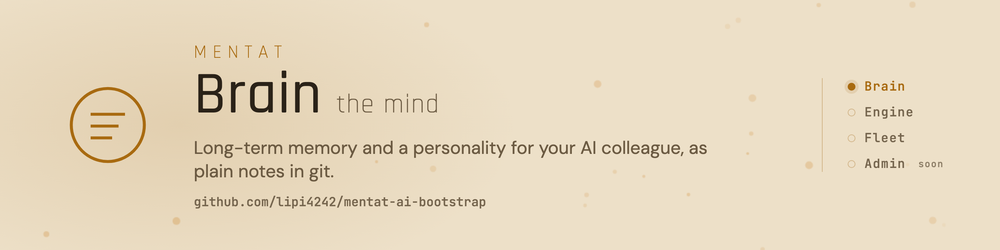
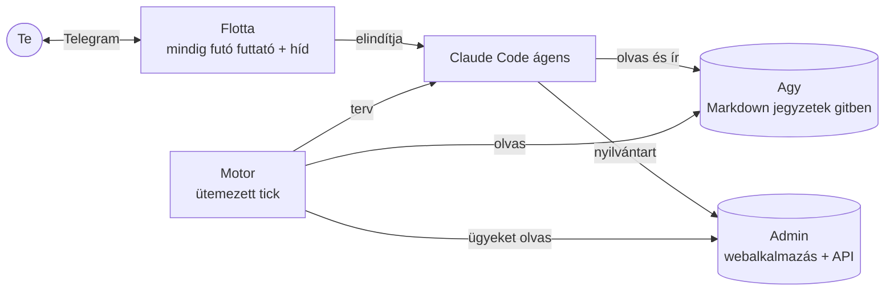

<picture>
  <source media="(prefers-color-scheme: dark)" srcset="assets/banner-dark.png">
  
</picture>

# Mentat

[](https://github.com/lipi4242/mentat/tags)
[](LICENSE)
[](https://docs.claude.com/en/docs/claude-code)
[](https://www.python.org/)
[](README.md)

A Mentat AI-kolléga: emlékszik rád, magától jelentkezik, és végigviszi, amit rábíztál, a te eszközeiddel, a te szabályaid szerint. A Claude Desktopban vagy a Claude Code-ban fut, a memóriáját sima jegyzetekként egy általad birtokolt mappában tartja, így minden session onnan indul, amit már tud rólad. Egy kis Linux szerveren akkor is dolgozik, amikor a laptopod le van csukva, és Telegramon beszélsz vele.

## Mit csinál

- Emlékszik az embereidre, ügyeidre és döntéseidre, és egy hosszú, akár bediktált gondolatfolyamból teendőket csinál.
- Kérés nélkül is jelentkezik: reggelente elmondja, mi késik és mi esedékes, minden határidő előtt három nappal és aznap is szól, és minden nyitott ügyet a listáján tart, amíg le nem zárul.
- Elvégzi a munkát a Google Naptárban, a Gmailben, a Táblázatokban és a Drive-on, Telegramon és a weben. Ha egy feladat szakértőt kíván, behív egy szakértő perszónát, a nagy munkákat pedig rögzített eljárás szerint viszi.
- A te szabályaid szerint dolgozik. Minden kockázatos lépés előtt kérdez, és mielőtt egy levél, meghívó vagy megosztott fájl kimenne, ellenőrzi, hogy csak azok kapják meg, akiket jóváhagytál. Az e-mail-címed az igened nélkül nem jut el harmadik félhez.
- Ott fut, ahol kell: a gépeden, több gépen, vagy éjjel-nappal egy szerveren, ami összeomlás után kb. egy perc alatt visszahozza.
- A nyilvántartásait egy kis webalkalmazásban is megmutatja: ott látod és szerkeszted az ügyeit és határidőit, és mindent kimenthetsz egy fájlba.

## Telepítés

Nyisd meg a Claude Desktopot, menj a Code fülre, és válassz egy új, üres mappát. Másold be:

```
Telepítsd nekem a Mentat asszisztenst ebbe a mappába.
A lépések itt vannak: https://raw.githubusercontent.com/lipi4242/mentat/v0.5.0/INSTALL.hu.md
Minden lépés előtt mondd el, mit csinálsz.
```

A Claude minden lépés előtt elmondja, mit fog csinálni, és mielőtt bármit telepítene, ami a gépedről hiányzik, megkérdez. Kell hozzá Claude Desktop vagy Claude Code, fizetős Claude-előfizetéssel. Minden lépés részletesen: [INSTALL.hu.md](INSTALL.hu.md). Utána úgy beszélsz vele, mint egy kollégával, a technikai lépéseket ő futtatja.

A telepítés beállítja a kollégát, és ha kéred a reggeli összefoglalót és az emlékeztetőket, a motort is. A szerveres futtatást és a webalkalmazást később, kérésre állítja be. Minden rész ugyanabból a kiadásból jön, így egyetlen verziót kell frissen tartanod.

## Meglévő business bekötése

Egy már működő vállalkozást (dokumentumokat, jegyzeteket, feladatlistákat, egy régi asszisztens memóriáját) így bízhatsz rá: „Kösd be magad a <név> businessbe.” A [bekötés](reference/bekotes/BEKOTES.hu.md) szerint dolgozik: megkérdezi, mit olvashat, és csak azt olvassa. Úgy van utasítva, hogy a gépeden máshol ne kutasson, a védelme pedig kérdez, mielőtt kinyúlna a mappájából, és tilt, ha nincs kit kérdezni.

## Mi van benne

Egy repó, egy verzió, egy telepítés: minden alábbi rész ebből a kiadásból jön.

| Rész | Mit csinál |
|---|---|
| Agy (ez a mappa: [hogyan működik](reference/how-it-works.hu.md)) | Maga a kolléga: memória sima jegyzetekben, gitben, személyiség, biztonsági szabályok, eszközök. |
| [Motor](engine/README.hu.md) | Az ütemezés: reggeli összefoglaló, határidő-emlékeztetők, és figyel minden nyitott ügyre. |
| [Flotta](fleet/README.hu.md) | Linux szerveren, éjjel-nappal futtatja az ágenseidet, és a Telegramhoz köti őket. |
| [Admin](admin/README.md) | Nem kötelező. Kis webalkalmazás az ágens nyilvántartásaihoz, a gépeden vagy a saját Cloudflare-fiókodon (a leírása angol). |



## Változások

Kiadási jegyzetek és frissítési lépések (angolul): [CHANGELOG.md](CHANGELOG.md). Minden változás képességenként: [CAPABILITY-LOG.hu.md](CAPABILITY-LOG.hu.md).

## Tovább

[Hogyan működik](reference/how-it-works.hu.md) · [Használat](reference/usage.hu.md) · [Biztonság](SECURITY.hu.md) · [Apache-2.0](LICENSE)
