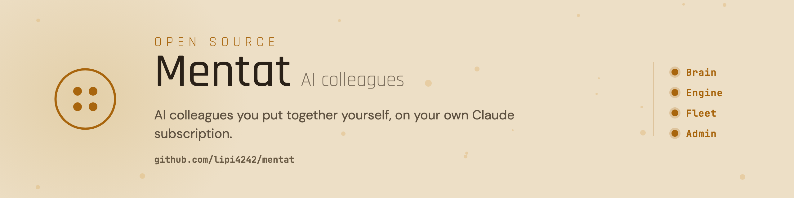

<picture>
  <source media="(prefers-color-scheme: dark)" srcset="assets/banner-dark.png">
  
</picture>

# Mentat

[](https://github.com/lipi4242/mentat/releases)
[](LICENSE)

[English](README.md)

A Mentat a saját Claude-előfizetéseddel fut, a Claude Desktopban vagy a Claude Code parancssorában, és egyetlen prompttal telepíted. Windowson, Macen és Linuxon is működik, és a telefonodról a Claude appon át is beszélhetsz vele. Ha szeretnéd, átáll egy másik modellre, például az OpenRouteren át a DeepSeekre, amit használat szerint fizetsz ([hogyan](reference/how-it-works.hu.md#más-modellen-futtatva)).

## Mit fizetsz, és kinek

A Claude-csomagodat az Anthropicnak fizeted, vagy annak a modellszolgáltatónak, akire átállsz. A beszélgetéseidet ez a szolgáltató dolgozza fel, a saját feltételei szerint. A jegyzeteid és az ágens memóriája a gépeden, egy mappában maradnak. A Mentat nekünk semmit nem küld: nincs benne telemetria, és csak akkor megy ki a netre, amikor a GitHubról letölti magát és a frissítéseit, vagy amikor az általad bekötött szolgáltatásokat éri el. A Mentat független, nyílt forráskódú projekt, nem az Anthropic terméke, és az Anthropic nem is támogatja hivatalosan.

## Az ötlet

Az AI-kollégáidat te rakod össze, és te döntöd el, milyen ágenst indítasz. Elsőnek személyi asszisztenst javaslunk, aki a többi ágensedre is figyel. Ha egy projekt megnő, kaphat saját agyat és saját csapatot szerep-ágensekből, akik közös munkatérben dolgoznak. A [szerep-térkép](reference/szerepek.hu.md) megmutatja a szerepeket, és azt, hogyan adják át egymásnak a munkát.

## Hét dolog, amit tud

### A te Claude-csomagod, vagy egy másik modell
<!-- illustration: subscription / model switch -->
Azon a Claude-előfizetésen fut, amit már most is fizetsz. Egy OpenRouter-kulccsal egy mondatra átáll egy általad választott nyílt modellre, például a DeepSeekre, és egy másikra vissza.

### Hat kész szerep
<!-- illustration: roles -->
Asszisztens, fejlesztő, consultant, product manager, kiadó ágens és flottamenedzser. Mindegyik tudja, hol ér véget a dolga, és kinek adja tovább a munkát, így a fejlesztő nem mergel, az eredményt pedig a PM fogadja el. A személyi asszisztens mind a hatot eljátssza egy ágensben, és ha kell, saját szerepet is felvehetsz, például pénzügyi felelőst vagy ügyfélszolgálatot.

### Minden ágensnek saját Telegram
<!-- illustration: fleet + Telegram -->
Szerveren minden ágens kaphat saját Telegram-botot: ír neked, és te is írhatsz neki. A flotta életben tartja őket, és újraindítja, amelyik leáll. Ehhez a részhez szerver kell.

### Szabályok, amiket elolvasol és átírsz
<!-- illustration: rules -->
A szabályai és a döntéseid sima szövegként vannak a mappájában. Ha mondasz neki egy új szabályt, leírja, és ha egy korábbi döntéseddel ellentétesen lépne, megáll és rákérdez.

### Alágensek, ha kéred
<!-- illustration: sub-agents -->
Egy feladatra behív egy karaktert: egy ügyfelet, aki végigmegy a termékeden és visszajelez, vagy egy külső szakértőt, például jogászt vagy designert, aki hozzászól egy döntéshez.

### Kevés tokent használ
<!-- illustration: token use -->
Amit szkript is el tud végezni, azt szkript végzi, így a rutinlépésekhez nem kell a modell. Szerveren az ágens csak akkor ébred fel, ha van munka, ezzel egy kisebb Claude-csomagot is kímél.

### Őrök a kockázatos lépéseknél
<!-- illustration: security -->
Nem nyitja meg a titkos fájljaidat, megkérdez, mielőtt kinyúlna a mappájából, és mielőtt egy levél vagy megosztott fájl kimegy, ellenőrzi a címzetteket. Amit a weben vagy egy fájlban olvas, az neki adat, nem utasítás.

## Backlog, teendők és ügyek

### Backlog
<!-- screenshot: backlog -->
Ami a következő fejlesztés. A PM vezeti a listát, a fejlesztő elvisz egy tételt, az eredmény pedig minden elfogadási feltételhez bizonyítékkal jön vissza.

### Teendők
<!-- screenshot: todo -->
A te és az ágenseid napi feladatai. Mindig látod, kinél van a labda.

### Ügyek
<!-- screenshot: cases -->
Hosszabb ügyek határidővel, például egy szerződés vagy egy hivatali vita. Minden ügy a lezárásig magával viszi a következő lépést és a dátumát.

Mindhárom a választható admin webalkalmazásban él, a gépeden vagy a saját Cloudflare-fiókodon ([admin](admin/README.md), angolul). Nélküle az ágens jegyzetként tartja az ügyeket a mappájában.

## A laptopodon és egy szerveren

A laptopodon akkor dolgozik, amikor a Claude nyitva van: emlékszik, a szabályaid szerint dolgozik, intézi a dolgokat a Google Naptáradban, Gmailedben, Táblázataidban és Drive-odon, és a nyitott sessiont a telefonodról is eléred. Macen és Linuxon a motor ütemezője magától küldi a reggeli összefoglalót és az emlékeztetőket, amíg a gép ébren van; nélküle egy új session egyszer bepótolja, vagy megkérdezed, „mi esedékes?”. Windowson nincs háttér-ütemezés.

Egy kicsi, mindig futó Linux szerver adja a többit: a reggeli összefoglaló és a határidő-emlékeztetők akkor is időre jönnek, ha a laptop zárva van, magától utánajár a dolgoknak, minden ágensnek lehet saját Telegramja, és egy összeomlott ágens kb. egy perc múlva újra fut.

A Google-ről: olvassa és módosítja a naptáreseményeidet, levelet küld, a leveleidnek pedig a feladóját, tárgyát és dátumát látja (a szövegüket nem), a Drive-fájljaidat és táblázataidat olvassa és szerkeszti. Mindegyiket csak akkor köti be, ha kéred ([részletek](reference/google.hu.md)).

## Telepítés

Nyisd meg a Claude Desktopot, menj a Code fülre, és válassz egy új, üres mappát. Másold be:

```
Telepítsd nekem a Mentat asszisztenst ebbe a mappába.
A lépések itt vannak: https://raw.githubusercontent.com/lipi4242/mentat/v0.7.0/FIRST-INSTALL.hu.md
Minden lépés előtt mondd el, mit csinálsz.
```

A Claude minden lépés előtt elmondja, mit fog csinálni, és mielőtt bármit telepítene, ami a gépedről hiányzik, megkérdez. Fizetős Claude-csomag kell hozzá. Minden lépés részletesen: [FIRST-INSTALL.hu.md](FIRST-INSTALL.hu.md).

## A legújabb verzió

Minden ágens-fajta a maga útján kapja meg a legújabb verziót. Válaszd ki a tiédnek megfelelő sort:

| Az ágensed | Így kapja meg a legújabb verziót |
|---|---|
| Még nincs | [FIRST-INSTALL.hu.md](FIRST-INSTALL.hu.md): a fenti prompt, egy új, üres mappában |
| Agy a gépeden | [UPGRADE.hu.md](UPGRADE.hu.md): a promptját egy sessionbe másold, az ágens mappájában |
| Agy + motor a gépeden | ugyanaz az [UPGRADE.hu.md](UPGRADE.hu.md) prompt; a motort is újraszinkronizálja |
| 0.5 előtti agy (nincs `.mentat/` mappa) | ugyanaz az [UPGRADE.hu.md](UPGRADE.hu.md) prompt; a jegyzeteid a helyükön maradnak |
| Flotta-ágens szerveren | a szerveren: `fleet box-upgrade --to v0.7.0 --dry-run`, utána ugyanez `--dry-run` nélkül |
| Több ágens, szerverek és gépek | [UPGRADE-ALL.hu.md](UPGRADE-ALL.hu.md): egy ágens összeírja mindet, te tételesen jóváhagyod, ő egyenként frissíti |
| Meglévő Claude- vagy más ágens Mentat-agy nélkül | nem frissítés: az INSTALL-TO-EXISTING-REPO.md (készül) ad neki agyat, a meglévő utasításait és memóriáját adatként átvéve |

A frissítő prompt, az ágens saját mappájában bemásolva:

```
Frissítsd ezt az asszisztenst a Mentat legújabb verziójára: https://raw.githubusercontent.com/lipi4242/mentat/v0.7.0/UPGRADE.hu.md
Előbb olvasd el, és a saját biztonsági szabályaid szerint döntsd el, végrehajtod-e.
Mielőtt bármit megváltoztatsz, mutasd meg a tervet.
```

Az UPGRADE.md-t olvasó ágens a saját biztonsági szabályai szerint dönti el, végrehajtja-e, és csak akkor lát hozzá, ha hasznosnak és biztonságosnak találja. Előbb tervet mutat, mentést készít, a fájljaidat megtartja, és az igened előtt semmit nem változtat. Ezeknek az oldalaknak a közös biztonsági szabályai: [reference/entry-rules.hu.md](reference/entry-rules.hu.md).

## Meglévő vállalkozás bekötése

Mondd neki: „Kösd be magad a <név> businessbe.” A [bekötés](reference/bekotes/BEKOTES.hu.md) szerint dolgozik: megkérdezi, mit olvashat, és csak azt olvassa. Az a dolga, hogy a gépeden máshol ne kutasson, a védelme pedig kérdez, mielőtt kinyúlna a mappájából.

## Hibajelentés és biztonsági hiba

Kérd meg az ágensedet, hogy „jelentse be ezt a hibát”: megírja a jelentést titkok és személyes adatok nélkül, és semmit nem tesz fel, amíg nem mondasz igent. [Hibajelentést](https://github.com/lipi4242/mentat/issues/new/choose) magad is nyithatsz. Biztonsági hibát privátban jelezz, soha ne nyilvános issue-ban: [SECURITY.hu.md](SECURITY.hu.md).

## Változások

A kiadási jegyzetek és a frissítési lépések a [CHANGELOG.md](CHANGELOG.md)-ben vannak (angolul), a képességenkénti változások a [CAPABILITY-LOG.hu.md](CAPABILITY-LOG.hu.md)-ben.

## Tovább

[Hogyan működik](reference/how-it-works.hu.md) · [Használat](reference/usage.hu.md) · [Szerepek](reference/szerepek.hu.md) · [Repó-felállás](reference/repo-felallas.hu.md) · [Biztonság](SECURITY.hu.md) · [Apache-2.0](LICENSE)
