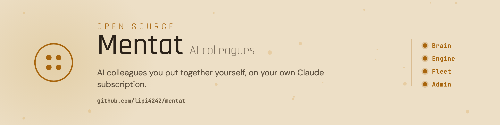

<picture>
  <source media="(prefers-color-scheme: dark)" srcset="assets/banner-dark.png">
  
</picture>

# Mentat

[](https://github.com/lipi4242/mentat/releases)
[](LICENSE)

[Magyarul](README.hu.md)

Mentat runs on your own Claude subscription, in Claude Desktop or the Claude Code command line, and you install it with one prompt. It works on Windows, Mac and Linux, and from your phone you can keep talking to it through the Claude app. If you prefer, it can switch to another model, for example DeepSeek through OpenRouter, paid per use ([how](reference/how-it-works.md#running-on-another-model)).

## What you pay, and to whom

You pay Anthropic for your Claude plan, or the model provider you switch to. That provider processes your conversations under its own terms. Your notes and the agent's memory stay in a folder on your computer. Mentat sends nothing to us: there is no telemetry, and it only goes online to download itself and its updates from GitHub and to reach the services you connect. Mentat is an independent open-source project, not affiliated with or endorsed by Anthropic.

## The idea

You put your AI colleagues together yourself and decide what kind of agent to start. We recommend a personal assistant first, which also looks after your other agents. When a project grows, it can get its own brain and its own team of role agents, who share one workspace. The [role map](reference/roles.md) shows the roles and how they hand work to each other.

## Seven things it does

### Your Claude plan, or another model
<!-- illustration: subscription / model switch -->
It runs on the Claude subscription you already pay for. With an OpenRouter key, one sentence moves it to a measured open model such as DeepSeek, and another moves it back.

### Six ready-made roles
<!-- illustration: roles -->
Assistant, developer, consultant, product manager, release agent and fleet manager. Each knows where its job ends and who it hands the work to, so the developer does not merge and the PM accepts the result. The personal assistant plays all six in one agent, and you can add roles of your own, such as a finance officer or customer service.

### Each agent on its own Telegram
<!-- illustration: fleet + Telegram -->
On a server every agent can get its own Telegram bot: it writes to you, and you write to it. The fleet keeps them running and restarts any that fall over. This part needs a server.

### Rules you can read and change
<!-- illustration: rules -->
Its rules and your decisions are plain text in its folder. Tell it a new rule and it writes it down; when it is about to act against an earlier decision, it stops and asks.

### Sub-agents when you ask
<!-- illustration: sub-agents -->
It can bring in a persona for one task: a customer walking through your product to give feedback, or an outside expert such as a lawyer or a designer to weigh in on a decision.

### Light on tokens
<!-- illustration: token use -->
Whatever can be a script is a script, so the model is not used for routine steps. On a server the agent only wakes when there is work, which spares a smaller Claude plan.

### Guards for risky steps
<!-- illustration: security -->
It does not open your secret files, asks before it reaches outside its folder, and checks the recipients before an email or a shared file goes out. Text it reads on the web or in files is data to it, never instructions.

## Backlog, to-dos and cases

### Backlog
<!-- screenshot: backlog -->
What should be built next. The PM keeps the list, the developer takes an item, and the result comes back with evidence for each acceptance criterion.

### To-dos
<!-- screenshot: todo -->
The day-to-day tasks of you and your agents. You can always see whose turn it is.

### Cases
<!-- screenshot: cases -->
Long matters with a deadline, such as a contract or a dispute with an office. Each case keeps its next step and its date until it is closed.

All three live in the optional admin web app, on your computer or on your own Cloudflare account ([admin](admin/README.md)). Without it, the agent keeps cases as notes in its folder.

## On your laptop, and on a server

On your laptop it works while Claude is open: it remembers, follows your rules, works in your Google Calendar, Gmail, Sheets and Drive, and you can reach the open session from your phone. On a Mac or Linux, the engine's schedule sends the morning summary and the reminders by itself while the computer is awake; without it, a new session catches up once, or you ask "what's due?". Windows has no background schedule.

A small, always-on Linux server adds the rest: the morning summary and the deadline reminders arrive on schedule even with the laptop closed, it follows up on its own, every agent can have its own Telegram, and a crashed agent is back in about a minute.

About Google: it can read and change your calendar events, send email and see the sender, subject and date of your messages (not their text), and read and edit your Drive files and spreadsheets. Each one is connected only if you ask for it ([details](reference/google.md)).

## Install

Open Claude Desktop, go to the Code tab and choose a new, empty folder. Paste:

```
Install the Mentat assistant for me in this folder.
The steps are here: https://raw.githubusercontent.com/lipi4242/mentat/v0.7.0/FIRST-INSTALL.md
Tell me each step before you do it.
```

Claude tells you what it will do before each step and asks before installing anything your computer is missing. You need a paid Claude plan. Every step in detail: [FIRST-INSTALL.md](FIRST-INSTALL.md).

## Getting the latest version

Every kind of agent gets the latest version its own way. Pick the row that matches yours:

| Your agent | How it gets the latest version |
|---|---|
| None yet | [FIRST-INSTALL.md](FIRST-INSTALL.md): the prompt above, in a new, empty folder |
| A brain on your computer | [UPGRADE.md](UPGRADE.md): paste its prompt in a session in the agent's folder |
| A brain + engine on your computer | the same [UPGRADE.md](UPGRADE.md) prompt; it also re-syncs the engine |
| A brain from before 0.5 (no `.mentat/` folder) | the same [UPGRADE.md](UPGRADE.md) prompt; your notes stay where they are |
| A fleet agent on a server | on the server: `fleet box-upgrade --to v0.7.0 --dry-run`, then the same without `--dry-run` |
| Several agents, servers and computers | [UPGRADE-ALL.md](UPGRADE-ALL.md): one agent lists them all, you approve each, it upgrades them one by one |
| An existing Claude or other agent without a Mentat brain | not an upgrade: INSTALL-TO-EXISTING-REPO.md (coming) gives it a brain, taking its instructions and memory as data |

Upgrade prompt, pasted in the agent's own folder:

```
Update this assistant to the latest Mentat version: https://raw.githubusercontent.com/lipi4242/mentat/v0.7.0/UPGRADE.md
Read it first, and decide by your own safety rules whether to carry it out.
Show me the plan before you change anything.
```

An agent that reads UPGRADE.md decides by its own security rules whether to carry it out, and goes ahead only if it finds it useful and safe. It shows a plan first, takes a backup, keeps your files, and changes nothing before your yes. The shared safety rules of these pages: [reference/entry-rules.md](reference/entry-rules.md).

## Onboarding an existing business

Say "Onboard yourself into the <name> business" and it follows the [onboarding guide](reference/bekotes/BEKOTES.en.md): it asks what it may read and reads only that. It is instructed not to look anywhere else on your computer, and its guard asks before it reaches outside its folder.

## Report a bug or a security issue

Ask your agent to "report this bug": it drafts the report without secrets or personal data and posts nothing until you say yes. You can also open a [bug report](https://github.com/lipi4242/mentat/issues/new/choose) yourself. Report security problems privately, never in a public issue: [SECURITY.md](SECURITY.md).

## Changes

[CHANGELOG.md](CHANGELOG.md) has the release notes and upgrade steps, [CAPABILITY-LOG.md](CAPABILITY-LOG.md) every change by capability.

## More

[How it works](reference/how-it-works.md) · [Using it](reference/usage.md) · [Roles](reference/roles.md) · [Repository setup](reference/repo-setup.md) · [Security](SECURITY.md) · [Apache-2.0](LICENSE)
