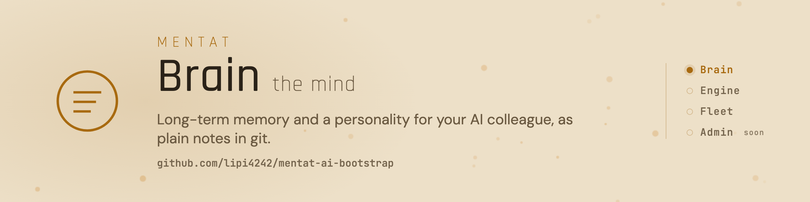
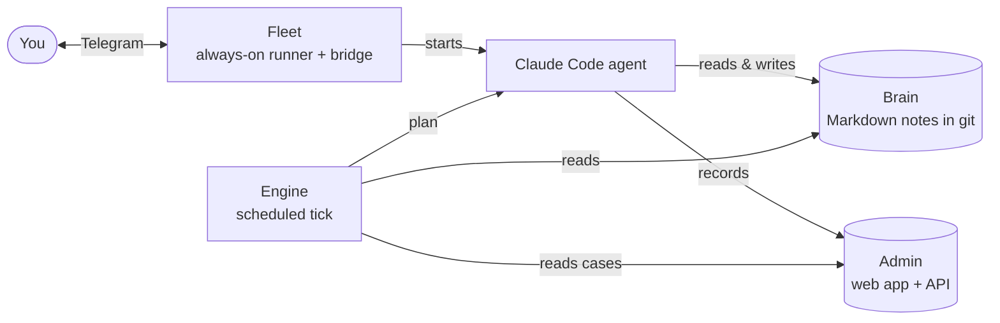

<picture>
  <source media="(prefers-color-scheme: dark)" srcset="assets/banner-dark.png">
  
</picture>

# Mentat

[](https://github.com/lipi4242/mentat/tags)
[](LICENSE)
[](https://docs.claude.com/en/docs/claude-code)
[](https://www.python.org/)
[](README.hu.md)

Mentat is an AI colleague that remembers you, follows up on its own, and gets things done with your tools, within the rules you set. It runs in Claude Desktop or Claude Code and keeps its memory as plain notes in a folder you own, so every session starts from what it already knows. On a small Linux server it keeps working while your laptop is closed, and you talk to it on Telegram.

## What it does

- Remembers your people, cases and decisions, and turns a long brain dump, even a dictated one, into todos.
- Follows up without being asked. Every morning you hear what is late and what is due, a reminder comes three days before each deadline and again on the day, and each open case stays on the list until it is closed.
- Does the work in Google Calendar, Gmail, Sheets and Drive, on Telegram and on the web. For a task that needs an expert it calls in an expert persona, and big jobs run by a set process.
- Stays inside your rules. It asks before anything risky, and before an email, an invite or a shared file goes out, it checks that only the people you approved receive it. Your e-mail address does not go to a third party without your yes.
- Runs where you need it: on your computer, on several computers, or day and night on a server that brings it back about a minute after a crash.
- Shows you its records, if you want, in a small web app where you see and edit its cases and deadlines and can export everything as one file.

## Install

Open Claude Desktop, go to the Code tab and choose a new, empty folder. Paste:

```
Install the Mentat assistant for me in this folder.
The steps are here: https://raw.githubusercontent.com/lipi4242/mentat/v0.5.0/INSTALL.md
Tell me each step before you do it.
```

Claude says what it will do before each step and asks before installing anything your computer is missing. You need Claude Desktop or Claude Code on a paid Claude plan. Every step in detail: [INSTALL.md](INSTALL.md). After that you talk to it like a colleague, and it runs the technical steps itself.

The install sets up the colleague and, if you want the morning summary and reminders, the engine. It sets up the server and the web app later, when you ask for them. Every part comes from the same release, so there is one version to keep up to date.

## Onboarding an existing business

Hand it a business you already run (documents, notes, task lists, an old assistant's memory) by saying: "Onboard yourself into the <name> business." It follows the [onboarding guide](reference/bekotes/BEKOTES.en.md), asks what it may read and reads only that. It is instructed not to look anywhere else on your computer, and its safety guard asks before it reaches outside its folder, and blocks it when nobody is there to ask.

## What's inside

One repository, one version, one install: every part below comes from this release.

| Part | What it does |
|---|---|
| Brain (this folder: [how it works](reference/how-it-works.md)) | The colleague itself: memory as plain notes in git, personality, safety rules and tools. |
| [Engine](engine/README.md) | The schedule: the morning summary, deadline reminders, and a watch on every open case. |
| [Fleet](fleet/README.md) | Runs your agents around the clock on a Linux server and connects them to Telegram. |
| [Admin](admin/README.md) | Optional. A small web app for the agent's records, on your computer or on your own Cloudflare account. |



## Changes

Release notes and upgrade steps: [CHANGELOG.md](CHANGELOG.md). Every change by capability: [CAPABILITY-LOG.md](CAPABILITY-LOG.md).

## More

[How it works](reference/how-it-works.md) · [Using it](reference/usage.md) · [Security](SECURITY.md) · [Apache-2.0](LICENSE)
