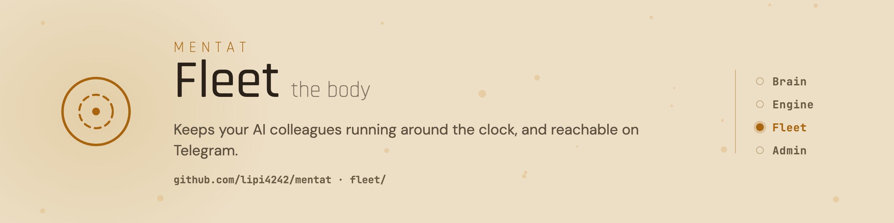

<picture>
  <source media="(prefers-color-scheme: dark)" srcset="assets/banner-dark.png">
  
</picture>

# Mentat Fleet

[](https://github.com/lipi4242/mentat/tags)
[](../LICENSE)
[](https://docs.claude.com/en/docs/claude-code)
[](https://www.python.org/)
[](README.md)

A flotta a [Mentat](../README.hu.md) része. Csak akkor kell, ha azt szeretnéd, hogy a kollégád akkor is dolgozzon, amikor a laptopod le van csukva. Éjjel-nappal futtatja a Mentat-kollégáidat egy kis Linux szerveren, legyen az havi néhány euróért bérelt gép vagy egy otthoni régi számítógép, és Telegramon beszélsz velük.

- Egy paranccsal jut el egy ágens a mappájától a futásig a szerveren.
- Minden ágenst figyel, összeomlás után kb. egy perc alatt visszahozza, és csak akkor mutat zöldet, ha az ágens tényleg dolgozik.
- Telegram mindkét irányban, minden kézbesített üzenetről nyugtával.
- Több ágens egy szerveren, mindegyik külön leállítható és újraindítható.
- Ellenőrzi, hogy minden ágens védelme valóban be van-e kapcsolva, és az igened nélkül nem engedi az e-mail-címedet harmadik félhez.

## Telepítés

A legegyszerűbb: kérd meg a Mentat-kollégádat, hogy tegye fel ezt a szerveredre, ő futtatja a lépéseket. Kézzel, a Linux szerveren (kell: `systemd --user`, `tmux`, a `claude` CLI, Python 3 és Node.js 18+), az egyetlen Mentat-checkoutból:

```sh
git clone --depth 1 --branch v0.6.0 https://github.com/lipi4242/mentat ~/src/mentat
mkdir -p ~/.local/bin && ln -sf ~/src/mentat/fleet/bin/fleet ~/.local/bin/fleet
cd ~/az-agens-repoja && fleet init az-agens && fleet setup az-agens
```

Ha a `~/src/mentat` már megvan (a motor ugyanezt a checkoutot használja), a klón helyett futtasd: `git -C ~/src/mentat fetch --tags && git -C ~/src/mentat checkout v0.6.0`.

A `fleet setup` 0-val lép ki, ha az ágens egészséges, 3-mal, ha fut, de még nem bizonyított, és 1-gyel hibánál, ilyenkor megadja az egy javító parancsot. Az ágenshez a flotta Claude Code-skilljeit is hozzáadja. Kézzel így: `claude plugin marketplace add lipi4242/mentat`, utána `claude plugin install fleet@mentat`. Részletek: [a flotta útmutatója](docs/workflows/fleet-guide.hu.md).

## Tovább

[A flotta útmutatója](docs/workflows/fleet-guide.hu.md) · [Lépésenkénti útmutatók](docs/workflows/) · [Kiadási jegyzetek (angolul)](../CHANGELOG.md) · [Minden változás képességenként](../CAPABILITY-LOG.hu.md) · [Biztonság](../SECURITY.hu.md) · [Apache-2.0](../LICENSE)
