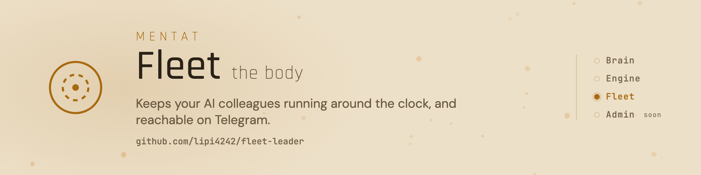

<picture>
  <source media="(prefers-color-scheme: dark)" srcset="assets/banner-dark.png">
  
</picture>

# Mentat Fleet

[](https://github.com/lipi4242/mentat/tags)
[](../LICENSE)
[](https://docs.claude.com/en/docs/claude-code)
[](https://www.python.org/)
[](README.hu.md)

The fleet is part of [Mentat](../README.md). You need it only if you want your colleague to keep working while your laptop is closed. It runs your Mentat colleagues day and night on a small Linux server, a rented one for a few euros a month or an old computer at home, and you talk to them on Telegram.

- One command takes an agent from its folder to running on the server.
- It watches every agent and brings it back about a minute after a crash; it shows green only when the agent is really working.
- Telegram in both directions, with a receipt for every delivered message.
- Several agents on one server, each stopped and restarted on its own.
- It checks that every agent's safety guard is really on, and keeps your e-mail address from going to a third party without your yes.

## Install

Easiest: ask your Mentat colleague to set this up on your server; it runs these steps for you. By hand, on the Linux server (needs `systemd --user`, `tmux`, the `claude` CLI, Python 3 and Node.js 18+), from the one Mentat checkout:

```sh
git clone --depth 1 --branch v0.5.0 https://github.com/lipi4242/mentat ~/src/mentat
mkdir -p ~/.local/bin && ln -sf ~/src/mentat/fleet/bin/fleet ~/.local/bin/fleet
cd ~/my-agent-repo && fleet init my-agent && fleet setup my-agent
```

If `~/src/mentat` is already there (the engine uses the same checkout), skip the clone and run `git -C ~/src/mentat fetch --tags && git -C ~/src/mentat checkout v0.5.0`.

`fleet setup` exits 0 when the agent is healthy, 3 when it runs but is not proven yet, and 1 on an error, with the one command that fixes it. It also adds the fleet's Claude Code skills to the agent. To add them by hand: `claude plugin marketplace add lipi4242/mentat`, then `claude plugin install fleet@mentat`. Details: [the fleet guide](docs/workflows/fleet-guide.md).

## More

[Fleet guide](docs/workflows/fleet-guide.md) · [Step-by-step guides (Hungarian)](docs/workflows/) · [Release notes](../CHANGELOG.md) · [Every change by capability](../CAPABILITY-LOG.md) · [Security](../SECURITY.md) · [Apache-2.0](../LICENSE)
