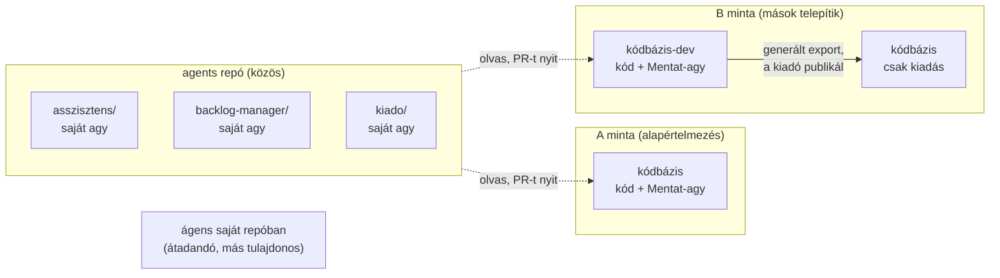

# Repó-felállás: hol él a kód, és hol élnek az ágensek

Ez a leírás azt ajánlja, hány repóra és milyen mappákra bontsd a munkát, ha a Mentat mellett
kódot is fejlesztesz, vagy több ágensed van. Telepítéskor és később is ehhez igazodunk.

## Röviden

- **Javasolt út: két repó.** Az egyik a kódbázis a saját Mentat-agyával. A másik egy közös
  `agents` repó: ebben él a flotta minden asszisztense és további Mentatja, mindegyik a saját
  agy-mappájában. Az ágensek tudnak egymásról, és olvashatják egymás tudását.
- **Ha a végterméket mások klónozzák vagy telepítik a GitHubról,** a kódbázis két repóra válik:
  egy csak kiadásra szolgáló repóra és egy fejlesztői (dev) repóra, amelyben az agy is van. Az
  `agents` repó ugyanúgy mellette marad.
- **Ágensenként külön repó csak indokkal jár:** ha az ágenst egyszer át kell adni valakinek, ha más
  a tulajdonosa, vagy ha olyan adat van nála, amit a flotta többi tagja nem láthat.

## Melyik minta a tiéd?

Egy kérdés dönt: **mások klónozzák vagy telepítik a végtermékedet a GitHubról?**

- **Nem** (egy webshop, egy cég honlapja, egy belső alkalmazás, egy szolgáltatás): **A minta.**
  Ez az alapértelmezés.
- **Igen** (egy nyílt forrású eszköz, egy könyvtár, egy telepíthető csomag, például maga a Mentat):
  **B minta.**

A kérdés valójában arról szól, hogy a terjesztett forrásból ki kell-e zárni a belső fejlesztési
anyagot. Egy weboldal, egy szolgáltatás vagy egy áruházban terjesztett alkalmazás nem a forrását
terjeszti, ezért az A minta.

Utána ágensenként egy második kérdés: **átadod-e egyszer ezt az ágenst, vagy más tulajdonosé az
adata?** Ha igen, saját repót kap. Ha nem, a közös `agents` repóba kerül.

## A két minta



Szövegesen: az A mintában egy kódbázis-repó van, benne a kód és a Mentat-agy. A B mintában a
dev repó hordozza a kódot és az agyat, és ebből generálódik a csak kiadásra szolgáló repó. Mindkét
mintában mellette áll a közös `agents` repó, ágensenként egy mappával. Az átadandó vagy más
tulajdonú ágens a saját repójában él.

### A minta: kódbázis Mentat-aggyal

A kódbázis repójában a kód mellett ott van a fejlesztői tudás is: `AGENTS.md`, az agy mappája a
döntésekkel, az architektúrával, a nyitott kérdésekkel, és ha van kiadó ágens, a kiadási recept
(`.release-agent/`). Itt dolgozik a fejlesztő. Személyes adat (levél, naptár, ügyfélnév) ebbe az
agyba nem kerül; az az asszisztensé.

### B minta: csak kiadás ← dev

A **csak kiadásra szolgáló** (release-only) repó azt jelenti:

- a tartalma generált: a dev repó egy kapuzott állapotából egy eszköz állítja össze;
- közvetlenül senki nem commitol bele, sem ember, sem ágens;
- a kiadó ágens (vagy a kiadási eszköz) tesz rá új commitot és verziócímkét, a történet átírása
  (force-push) nélkül, a publikálás pedig emberi jóváhagyáshoz kötött lépés;
- a felhasználók hibajelentései és PR-jai ide érkezhetnek, de itt nem mergelünk: a változást a
  dev repóba vesszük át, a szerző feltüntetésével, és a következő kiadás viszi ki.

A dev repó a valódi munkaterület: kód, tesztek, belső anyag (biztonsági jegyzetek, tervek), és a
Mentat-agy. A kiadási eszköz gondoskodik róla, hogy a belső anyag ne kerüljön a publikus fába.

## Az `agents` repó

```
agents/
  README.md              ki lakik itt, melyik boxon fut
  .release-agent/        egy kiadási recept, ágens-mappánként egy sáv
  asszisztens/           AGENTS.md, CLAUDE.md, agy/, mentat.json, .mentat/
  backlog-manager/       ugyanez
  kiado/                 ugyanez
```

- **A gyökérben nincs személyiséget hordozó `CLAUDE.md` vagy `AGENTS.md`.** A Claude Code a
  munkamappa feletti `CLAUDE.md` fájlokat is betölti, így egy gyökérszintű személyiség minden
  ágensbe beszivárogna. A gyökérben csak a README és a kiadási recept van.
- **Minden ágens a saját mappájából indul.** A flotta-registry `workdir` mezője az ágens mappájára
  mutat (például `%h/agents/kiado`), a Claude-session ott nyílik meg.
- **Egy gépen minden ágensnek saját klónja vagy worktree-je van.** Közös checkoutban az egyik ágens
  ágváltása kihúzza a fájlokat a többiek alól.
- A titkok ágensenként, gitignore-olt fájlban vagy a repón kívül élnek, ugyanúgy, mint külön
  repóban.

### Mit láthatnak egymásból

- **Olvasni szabad.** Ez a közös repó haszna: a backlog-manager látja a kiadó naplóját, az
  asszisztens tudja, mit döntött a fejlesztő.
- **Írni csak a saját mappájába ír** egy ágens, hacsak a szerepe kifejezetten meg nem engedi a
  többet. Más ágens agyának vagy szabályfájljának módosítása PR, a gazda jóváhagyásával.
- **A közös repó nem adatvédelmi határ.** Ami a repóba és a történetébe kerül, azt minden ágens
  láthatja. Ami csak egy ágensre tartozik, az a saját repójába vagy a repón kívülre megy.
- **Más ágens titka és Claude-átirata nem olvasható.** Ezt a titok-kapu tiltja, közös repóban is.
- **Ismert korlát:** az ágens-határ őre ma a git-gyökér alapján dönti el, mi számít „más
  ágensnek”. Egy közös repón belül ezért nem állítja meg, ha valaki a szomszéd mappájában a
  szabályfájlt írja. Ezt a kiadási sávok fogják meg: a szabályfájl változása emberi jóváhagyású
  sávon megy. Ha egy szerepnek a szomszéd mappák írását is tiltani kell, vedd fel őket a
  szerepfájl tiltólistájára.

### Kiadás egy közös repóban

Egy repó, egy kiadási recept. A sávok ágens-mappánként válnak szét (`asszisztens/`,
`kiado/`…), és minden ágens szabályfájljai (`AGENTS.md`, `CLAUDE.md`, `.claude/`) külön, emberi
jóváhagyású sávon mennek. Ha egy PR két ágens mappájához nyúl, két sávot érint, és emberi sáv nem
utazik más sávval egy PR-ban.

## Mikor kap egy ágens saját repót

- **Átadandó:** az ágens egy ügyfélé lesz, vagy valakinek a saját fiókjába kerül. A saját repó a
  teljes történettel együtt átadható, és nem visz magával mást.
- **Más a tulajdonos:** egy családtag, egy partnercég vagy egy ügyfél fiókjában él.
- **Adatvédelmi határ:** olyan adattal dolgozik (biztosítási, egészségügyi, pénzügyi), amit a
  flotta többi tagja nem láthat. Ilyenkor gyakran a gép és a flotta is külön van (lásd lent).

## Határesetek

- **Egy repóban több termék:** a minta publikálási határonként dől el. Egy dev repóból több
  generált kiadás is készülhet, mindegyik a saját verziójával.
- **Nyíltan fejlesztett kód** (minden PR publikus, nincs belső anyag): A minta egy publikus
  repóban; az agyába csak az kerülhet, ami publikus is lehet.
- **Open-core:** a publikus mag A vagy B, a privát kiegészítés külön privát repóban vagy a dev
  repó nem kiadott részében él.
- **Ügyfél tulajdonában lévő kódbázis:** A minta, a repó az ügyfélnél. Előbb tisztázd, hogy a te
  ágenseid olvashatják-e, és hol maradhat a belőle készült jegyzet és napló. Ha ez nálad nem
  maradhat, az ágens az ügyfél gépén fut.
- **Fork:** ha a forkot mások telepítik, B; különben A.
- **Adat-, infrastruktúra- vagy konfigurációs repó:** nem termék; hozzáférés szerint külön
  privát repó, titok és futási adat nélkül.
- **Több kódbázist kiszolgáló ágens:** az `agents` repóban él; ami egy kódbázisra tartozik, az a
  kódbázis agyába kerül, a kiadási recept minden kezelt repóban külön van.
- **Több tulajdonos:** közös repó csak akkor, ha a hozzáférés, az átadás és a törlés szabályai
  mindenkinél ugyanazok.
- **Ágens kódbázis nélkül:** elég az `agents` repó.

## Miért külön agy, ha egy repóban vannak is

Külön agy nem jelent külön repót: a közös `agents` repóban is mindenkinek saját agy-mappája van.
A kódbázis agya és az asszisztensek agya négy okból válik szét:

- **Adatvédelem:** az asszisztens levelet, naptárat, ügyfélneveket lát. A kódbázis agyát a
  fejlesztők olvassák, B mintában a publikus kód közvetlen szomszédságában.
- **Szerephatár:** a fejlesztő kódot ír, az asszisztens nem. Külön agy = külön szabályfájl és
  külön szerep-őr.
- **Más ritmus:** az asszisztens naponta többször jegyzetel, a kódbázis PR-ral és kapukkal
  változik. Egy agyban minden jegyzet kiadási kört indítana.
- **Átadhatóság:** az ügyfélnek átadott ágens viszi a saját agyát, a kódbázis maradhat.

## Szerepek a két mintában

| Szerep | Hol él az agya | A minta | B minta |
|---|---|---|---|
| fejleszto | a kódbázis repójában (A) vagy a dev repóban (B) | ágon dolgozik, PR-t nyit, nem mergel | ugyanígy a dev repóban; a csak-kiadás repóba nem ír |
| kiado | az `agents` repóban; a recept a kezelt repóban (`.release-agent/`) | kapuz, a kódbázis fő ágára mergel, élesít | kapuz, a dev fő ágára mergel; a csak-kiadás repóba publikálás külön, emberi jóváhagyású lépés |
| backlog-manager | az `agents` repóban | jegyek, prioritások, a kódbázist olvassa | ugyanígy; a felhasználói hibajelentésekből a dev backlogra visz jegyet |
| asszisztens | az `agents` repóban | napi ügyek, a kódbázist legfeljebb olvassa | ugyanígy |

A szerepek tudnak egymásról: a fejlesztő tudja, hogy a PR-jét a kiadó mergeli, és hogy a jegyeit
a backlog-manager rendezi.

## Hol futnak: gép, flotta, előfizetés

- **Egy szerver (box) általában egy flottát szolgál ki,** és egy flotta általában egy
  Claude-előfizetésen fut: az ágensei ugyanazon a bejelentkezésen osztoznak.
- **Egy flottához általában egy `agents` repó tartozik.**
- **Második gép vagy előfizetés** két esetben kell: ha külön flotta indul (egy másik szervezet,
  egy ügyfél, vagy egy érzékeny adatkör, amit el kell választani), vagy ha az egyik gép memóriája
  vagy az előfizetés kerete kevés.
- A gép, a flotta és az előfizetés üzemeltetési egység, nem jogosultság: a közös előfizetés
  semmire nem ad engedélyt.

## Ki ajánlja, és mikor

- Telepítéskor a telepítő megkérdezi a fenti két kérdést, az A mintát javasolja, a B-t csak akkor,
  ha igaz rá, és a választást döntésként rögzíti (`reference/repo-felallas-ajanlas.hu.md`).
- Később az asszisztens és a backlog-manager is felajánlhatja, ha új kódbázis, új ágens vagy
  kiadás kerül szóba. Ha a gazda kéri, backlog-tételt nyit a kialakítására. Magától semmit nem
  költöztet.
