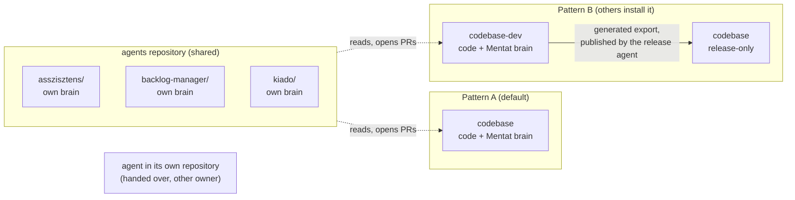

# Repository setup: where the code lives, and where the agents live

This page recommends how many repositories to use and how to lay out their folders when you
build code alongside Mentat or run more than one agent. Installs and later advice follow it.

## In short

- **Recommended: two repositories.** One is the codebase with its own Mentat brain. The other is
  a shared `agents` repository where every assistant and further Mentat of the fleet lives, each
  in its own brain folder. The agents know about each other and can read each other's knowledge.
- **If others clone or install your end product from GitHub,** the codebase splits in two: a
  release-only repository and a development (dev) repository that also holds the brain. The
  `agents` repository stays next to them.
- **A repository per agent needs a reason:** the agent will be handed over to someone, it has a
  different owner, or it holds data the rest of the fleet must not see.

## Which pattern is yours?

One question decides: **do others clone or install your end product from GitHub?**

- **No** (a web shop, a company website, an internal app, a service): **pattern A.** This is the
  default.
- **Yes** (an open-source tool, a library, an installable package, Mentat itself): **pattern B.**

What the question really asks is whether the source you distribute must leave out internal
development material. A website, a service or an app distributed through a store does not
distribute its source, so it is pattern A.

Then, per agent: **will you hand this agent over one day, or does its data belong to someone
else?** If yes, it gets its own repository. If not, it goes into the shared `agents` repository.

## The two patterns



In words: in pattern A there is one codebase repository holding the code and the Mentat brain. In
pattern B the dev repository holds the code and the brain, and the release-only repository is
generated from it. In both, the shared `agents` repository sits alongside, one folder per agent.
An agent that will be handed over, or that someone else owns, lives in its own repository.

### Pattern A: the codebase with a Mentat brain

Next to the code, the codebase repository holds the development knowledge: `AGENTS.md`, the brain
folder with decisions, architecture and open questions, and, if a release agent works on it, the
release recipe (`.release-agent/`). The developer works here. Personal data (mail, calendar,
client names) does not go into this brain; that belongs to the assistant.

### Pattern B: release-only ← dev

A **release-only** repository means:

- its content is generated: a tool composes it from a gated state of the dev repository;
- nobody commits to it directly, neither a person nor an agent;
- the release agent (or the release tool) adds a new commit and a version tag without rewriting
  history (no force-push), and publishing is a step that needs a human's approval;
- users may file bug reports and PRs there, but nothing is merged there: the change is taken over
  into the dev repository, crediting the author, and the next release carries it out.

The dev repository is the real workspace: code, tests, internal material (security notes,
designs) and the Mentat brain. The release tool keeps the internal material out of the public
tree.

## The `agents` repository

```
agents/
  README.md              who lives here, which server each runs on
  .release-agent/        one release recipe, one lane per agent folder
  asszisztens/           AGENTS.md, CLAUDE.md, brain/, mentat.json, .mentat/
  backlog-manager/       the same
  kiado/                 the same
```

- **No `CLAUDE.md` or `AGENTS.md` with a persona at the root.** Claude Code also loads the
  `CLAUDE.md` files above the working folder, so a persona at the root would leak into every
  agent. The root holds only the README and the release recipe.
- **Each agent starts in its own folder.** The fleet registry's `workdir` points at the agent's
  folder (for example `%h/agents/kiado`), and the Claude session opens there.
- **On one machine every agent has its own clone or worktree.** In a shared checkout one agent's
  branch switch pulls the files out from under the others.
- Secrets live per agent, in a gitignored file or outside the repository, just as in a separate
  repository.

### What they can see of each other

- **Reading is allowed.** That is the point of the shared repository: the backlog-manager sees the
  release agent's log, the assistant knows what the developer decided.
- **An agent writes only into its own folder,** unless its role explicitly allows more. Changing
  another agent's brain or rule files is a PR, approved by the owner.
- **The shared repository is not a privacy boundary.** Whatever goes into the repository and its
  history, every agent can see. What belongs to one agent only goes into its own repository or
  outside the repository.
- **Another agent's secrets and Claude transcripts are not readable.** The secrets gate blocks
  them, in a shared repository too.
- **Known limit:** the agent-boundary guard decides what counts as "another agent" by the git
  root. Inside a shared repository it therefore does not stop a write to the neighbour folder's
  rule files. The release lanes catch that: a rule-file change goes through a lane that needs a
  human's approval. If a role must not write the neighbouring folders at all, add them to the
  role file's deny list.

### Releasing from a shared repository

One repository, one release recipe. Lanes split by agent folder (`asszisztens/`, `kiado/`…),
and each agent's rule files (`AGENTS.md`, `CLAUDE.md`, `.claude/`) go through their own lane with
human approval. A PR that touches two agents' folders touches two lanes, and a human lane never
rides in the same PR as another lane.

## When an agent gets its own repository

- **To be handed over:** the agent will belong to a client, or move to someone's own account. Its
  own repository can be transferred with its full history, and takes nothing else along.
- **A different owner:** it lives in a family member's, a partner company's or a client's account.
- **A privacy boundary:** it works with data (insurance, health, financial) the rest of the fleet
  must not see. Then the machine and the fleet are often separate too (see below).

## Edge cases

- **Several products in one repository:** the pattern is decided per publication boundary. One dev
  repository can produce several generated releases, each with its own version.
- **Code developed in the open** (every PR public, no internal material): pattern A in a public
  repository; its brain may only hold what could be public.
- **Open-core:** the public core is A or B, the private extension lives in a separate private
  repository or in a part of the dev repository that is never released.
- **A codebase owned by a client:** pattern A, the repository stays with the client. First agree
  whether your agents may read it and where notes and logs made from it may stay. If they cannot
  stay with you, the agent runs on the client's machine.
- **A fork:** if others install the fork, B; otherwise A.
- **A data, infrastructure or configuration repository:** not a product; a separate private
  repository by access, without secrets or runtime data.
- **An agent serving several codebases:** it lives in the `agents` repository; what belongs to one
  codebase goes into that codebase's brain, and each managed repository has its own release recipe.
- **Several owners:** one shared repository only if access, handover and deletion rules are the
  same for all of them.
- **An agent without a codebase:** the `agents` repository is enough.

## Why separate brains, even in one repository

A separate brain is not a separate repository: in the shared `agents` repository every agent still
has its own brain folder. The codebase brain and the assistants' brains stay apart for four reasons:

- **Privacy:** the assistant sees mail, calendars and client names. The codebase brain is read by
  developers, and in pattern B it sits right next to public code.
- **Role boundaries:** the developer writes code, the assistant does not. A separate brain means
  separate rule files and a separate role guard.
- **A different cadence:** the assistant takes notes several times a day, the codebase changes
  through PRs and gates. In one brain every note would start a release round.
- **Handover:** an agent handed over to a client takes its own brain; the codebase can stay.

## Roles in the two patterns

| Role | Where its brain lives | Pattern A | Pattern B |
|---|---|---|---|
| fejleszto (developer) | the codebase repository (A) or the dev repository (B) | works on a branch, opens a PR, never merges | the same in the dev repository; never writes to the release-only repository |
| kiado (release agent) | the `agents` repository; the recipe in the managed repository (`.release-agent/`) | gates, merges to the codebase's main branch, deploys | gates, merges to the dev main branch; publishing to the release-only repository is a separate step with human approval |
| backlog-manager | the `agents` repository | tickets, priorities, reads the codebase | the same; turns users' bug reports into tickets on the dev backlog |
| asszisztens (assistant) | the `agents` repository | daily affairs, at most reads the codebase | the same |

The roles know about each other: the developer knows the release agent merges its PR and the
backlog-manager orders its tickets.

## Where they run: server, fleet, subscription

- **One server (box) usually serves one fleet,** and one fleet usually runs on one Claude
  subscription: its agents share the same login.
- **One fleet usually has one `agents` repository.**
- **A second server or subscription** is for two cases: a separate fleet (another organisation, a
  client, or a sensitive data domain that has to be kept apart), or capacity, when one machine's
  memory or the subscription's limits run short.
- The server, the fleet and the subscription are operating units, not permissions: a shared
  subscription grants nothing.

## Who recommends it, and when

- At install, the installer asks the two questions above, recommends pattern A, offers B only when
  it applies, and records the choice as a decision (`reference/repo-setup-recommendation.md`).
- Later the assistant and the backlog-manager can offer it too, when a new codebase, a new agent
  or a release comes up. If the owner asks, they open a backlog item to set it up. They never
  move anything on their own.
